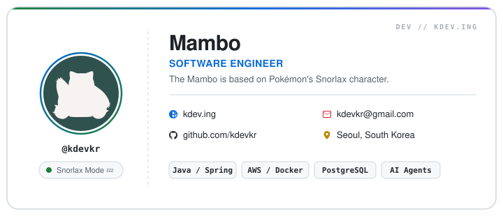

<!-- Digital Business Card (Auto Light/Dark) -->
<a href="https://kdev.ing">
  <picture>
    <source media="(prefers-color-scheme: dark)" srcset="./card-dark.svg" />
    <source media="(prefers-color-scheme: light)" srcset="./card-light.svg" />
    
  </picture>
</a>

 

  
  &nbsp;
  
  &nbsp;
  

---

### 🛠 Tech Stack

<table>
  <tr>
    <td align="center" width="160"><strong>Backend</strong></td>
    <td>
      
      
      
    </td>
  </tr>
  <tr>
    <td align="center"><strong>Frontend</strong></td>
    <td>
      
      
      
    </td>
  </tr>
  <tr>
    <td align="center"><strong>Database</strong></td>
    <td>
      
      
      
    </td>
  </tr>
  <tr>
    <td align="center"><strong>Cloud & Infra</strong></td>
    <td>
      
      
      
      
    </td>
  </tr>
  <tr>
    <td align="center"><strong>Tools</strong></td>
    <td>
      
      
    </td>
  </tr>
</table>

 

### 📊 GitHub Activity

  <a href="https://github.com/kdevkr">
    <picture>
      <source media="(prefers-color-scheme: dark)" srcset="https://github-stats-extended.vercel.app/api?username=kdevkr&show_icons=true&bg_color=161b22&border_color=30363d&title_color=58a6ff&text_color=c9d1d9&icon_color=2ea043&disable_animations=true" />
      <source media="(prefers-color-scheme: light)" srcset="https://github-stats-extended.vercel.app/api?username=kdevkr&show_icons=true&bg_color=ffffff&border_color=d0d7de&title_color=0969da&text_color=1f2328&icon_color=1a7f37&disable_animations=true" />
      
    </picture>
  </a>
  <a href="https://github.com/kdevkr">
    <picture>
      <source media="(prefers-color-scheme: dark)" srcset="https://github-stats-extended.vercel.app/api/top-langs/?username=kdevkr&layout=compact&bg_color=161b22&border_color=30363d&title_color=58a6ff&text_color=c9d1d9&disable_animations=true" />
      <source media="(prefers-color-scheme: light)" srcset="https://github-stats-extended.vercel.app/api/top-langs/?username=kdevkr&layout=compact&bg_color=ffffff&border_color=d0d7de&title_color=0969da&text_color=1f2328&disable_animations=true" />
      
    </picture>
  </a>

 

